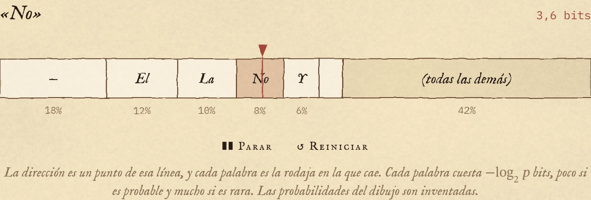
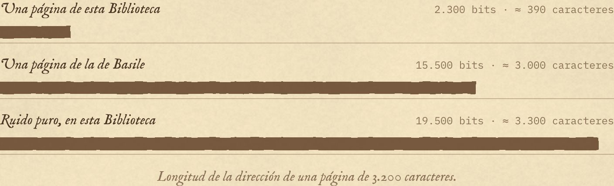
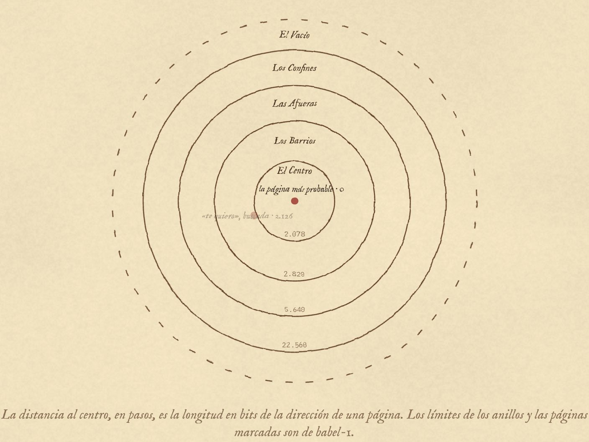
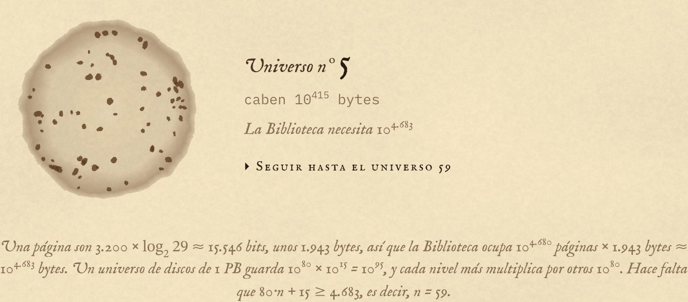
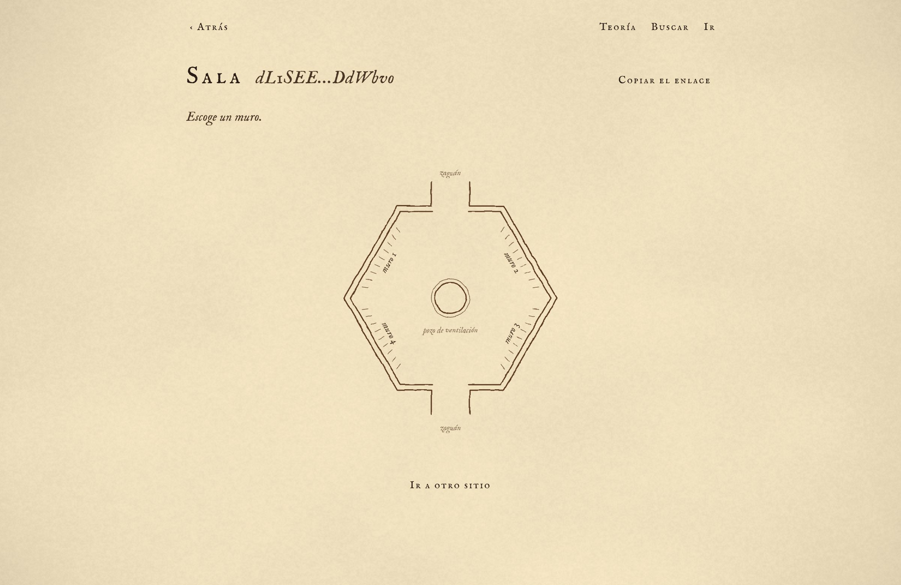
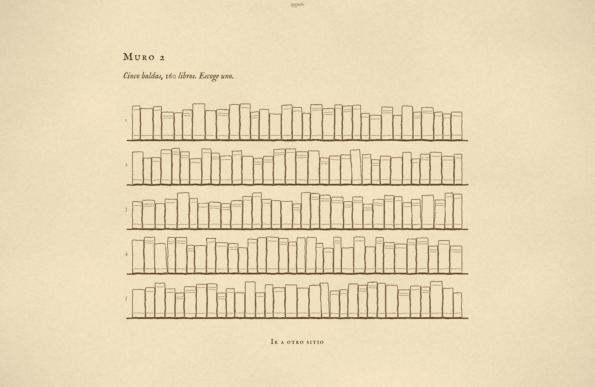
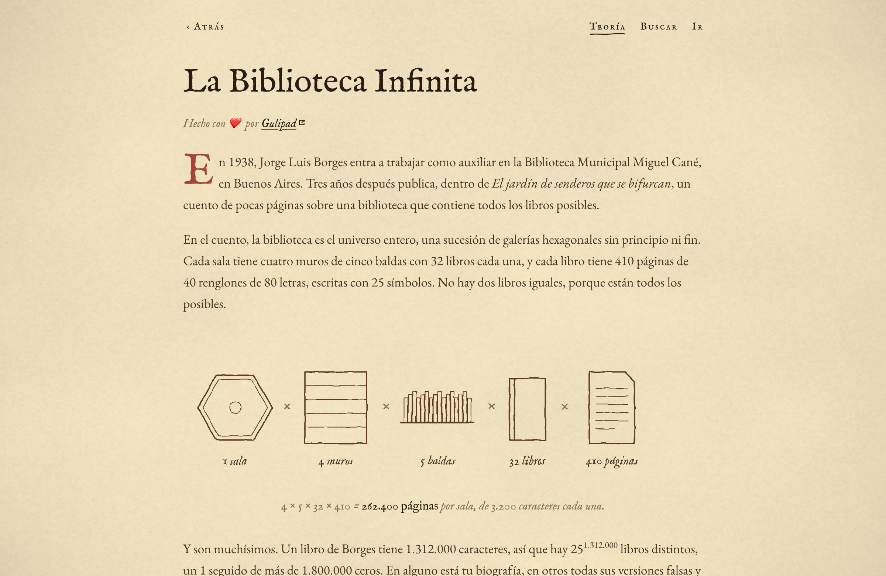
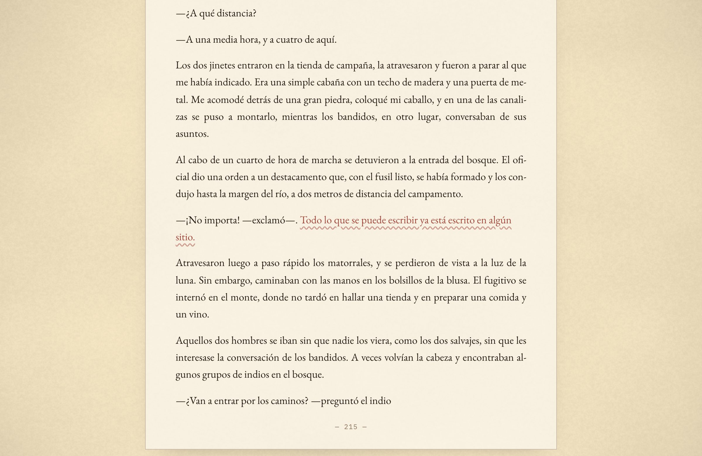

<p align="center">
  
</p>

# La Ciudad de Babel

**Borges's Library of Babel, in Spanish, with a language model as its cartographer.**
→ [babel.gulipad.com](https://babel.gulipad.com)

In 1941 Borges imagined a library holding every possible book. In 2015 Jonathan Basile
[built it](https://libraryofbabel.info): every page of 3,200 characters exists, and an invertible
function maps each address to its page. Nothing is stored. But almost every page is noise, and the
address of a page is as long as the page itself.

This is a Library of Babel for Spanish. Every page still exists, but a small language model decides
how the shelves are weighted. Readable prose sits near the centre, noise is pushed out to the edges, and
an address is the page compressed. A typical page's address is between six and seven times shorter than Basile's.

## Every page is a number

The model reads like a writer rolling a die at every word. An address is the list of rolls, packed into
one number. **Browsing** unpacks the rolls and lets the model write. **Searching** asks, at each word,
which roll would have produced it. The rolls are arithmetic coding (rANS) over the model's
probabilities: an exact, invertible map between numbers and pages.

<p align="center"></p>

Each word costs −log₂ p bits, so a page's address is as long as what the model couldn't predict about
it. Basile's library expects nothing, so every page costs the same; this one knows Spanish, and
spends short addresses on the pages people read.

<p align="center"></p>

## A geography

Address length becomes distance. **El Centro** is the most probable page (address `babel-1:0:1:1:1:1`,
zero steps). Around it lie Los Barrios, Las Afueras, Los Confines and El Vacío, where the noise
lives. «te quiero», searched, lands 2,126 steps from the centre.

<p align="center"></p>

You can't store it, though. The library needs about 10⁴⁶⁸³ bytes: a universe where every atom is a 1 PB
disk holds 10⁹⁵, and you'd need to nest universes inside atoms 59 times before it fit.

<p align="center"></p>

## The city

Three ways in: **Teoría**, an illustrated essay on how it all works; **Buscar**, which finds any
sentence on a page; and **Ir**, which goes to an address or a random room. From a room you pick a
wall, a shelf, a book and a page, as in Borges.

|                                                                                       |                                                                                    |
| ------------------------------------------------------------------------------------- | ---------------------------------------------------------------------------------- |
|  |                           |
|                           |  |

A search always gives you the same page for the same sentence, at an ordinary address among all the
others. No room was built for you: the page around your words is written by the same model, and you
could wander into it by chance (it's just very unlikely).

## The model _is_ the universe

An address must open the same page on every device, forever. Floating-point maths differs between
GPUs and browsers, so the model runs on an **integer-only engine** (int8 weights, int32 sums,
lookup-table nonlinearities) in WebAssembly, bit-exact everywhere. Everything that decides a page
(weights, tokenizer, sampling rules, codec) is frozen into a **universe**, pinned by SHA-256 in
[`manifest.json`](lab/universes/babel-1/manifest.json). Every address names its universe (`babel-1:…`),
so a new model becomes a new universe and old links keep working.

The model, **librarian-1**, has 66M parameters and was trained from scratch on 83k pages of
public-domain Spanish prose (Gutenberg, Wikisource, Elejandría), forwards and partly backwards. The
backward reading lets search write the text that leads _into_ your sentence. On unseen pages it
scores 1.138 bits per character, against 1.156 for Salamandra, a 2B-parameter Spanish model. Training
cost about $15 of rented GPUs.

Everything runs in your browser. The 77 MB model downloads once and is checked against the manifest
before it writes a word.

## Repository

|                                                   |                                                                     |
| ------------------------------------------------- | ------------------------------------------------------------------- |
| [`app/`](app)                                     | The city: SvelteKit, every page computed on the reader's device     |
| [`lab/`](lab)                                     | Training, the integer engine, evaluations, and the frozen universes |
| [`lab/universes/babel-1/`](lab/universes/babel-1) | The universe the city reads (the model itself is not in git)        |
| [`docs/article-notes.md`](docs/article-notes.md)  | The maths, the measurements and the experiments, in detail          |
| [`deploy/`](deploy)                               | Publishing a universe to R2 and the city to Cloudflare              |

## Running it

```sh
deploy/fetch-universe.sh babel-1     # downloads the model (77 MB) and checks its hashes
cd app
pnpm install
pnpm dev                             # http://localhost:5173
```

Requires Node 22. To deploy, `deploy/publish-universe.sh babel-1` uploads a universe to the R2 bucket
and `deploy/deploy-app.sh` builds and deploys the city.

## Thanks

Jorge Luis Borges, _La biblioteca de Babel_ (1941). Jonathan Basile, [libraryofbabel.info](https://libraryofbabel.info).
Built by [Gulipad](https://gulipad.com) with Claude.
